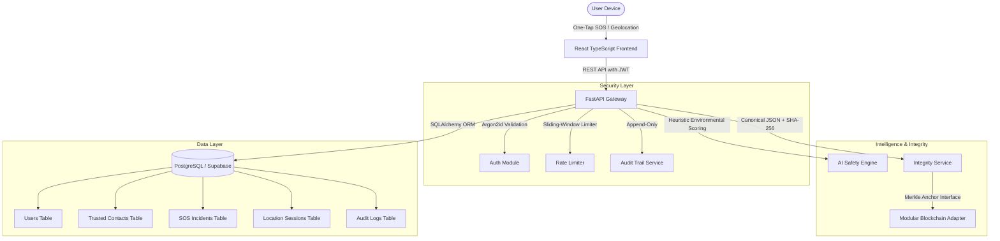

# SHAKTISHIELD AI - SYSTEM ARCHITECTURE SPECIFICATION

## 1. Executive Architecture Summary

SHAKTISHIELD AI is an end-to-end full-stack women's safety ecosystem engineered with modern microservice and serverless compatibility. The system emphasizes:
- **Instant Emergency Response:** Sub-second one-tap SOS activation.
- **Privacy-Preserving Geolocation:** Geolocation permission required exclusively during user-initiated events.
- **Cryptographic Non-Repudiation:** SHA-256 canonical hashing ensures digital evidentiary integrity for legal and investigative authorities.
- **Modular AI Situational Intelligence:** Environmental hazard scoring and tactical advice.

## 2. Component Breakdown

### Frontend (Client Tier)
- **Framework:** React 18 with TypeScript and Vite.
- **Styling:** Vanilla Tailwind CSS with custom purple-navy dark mode design system, glassmorphism, glowing borders, and accessible high-contrast emergency triggers.
- **State Management:** React Context API (`AuthContext`, `ToastContext`).
- **Geolocation API:** High-accuracy browser geolocation with sub-meter accuracy radius indicators.

### Backend (API Tier)
- **Framework:** Python 3.11/3.13 FastAPI with asynchronous request handling.
- **Security & Cryptography:** 
  - Password Hashing: Argon2id (`argon2-cffi`) with memory-hard parameters.
  - Session Tokens: JSON Web Tokens (PyJWT) with expiration and subject validation.
  - Rate Limiting: In-memory sliding window rate limiter on `/api/auth/login`, `/api/auth/register`, and `/api/sos`.
  - Canonical Hashing: SHA-256 deterministic serialization of incident payload attributes.

### Database (Data Tier)
- **ORM:** SQLAlchemy 2.0 with connection pooling and dialect translation.
- **Relational Storage:** PostgreSQL 16 (production on Supabase, local development compatibility with SQLite).
- **Migration Engine:** Alembic versioned migration tracking.

### Operational Transparency
- **Demo Mode:** Prominent system banners prevent false claims of automated police intervention unless verified external third-party telecom credentials (Twilio / SendGrid) are configured.
